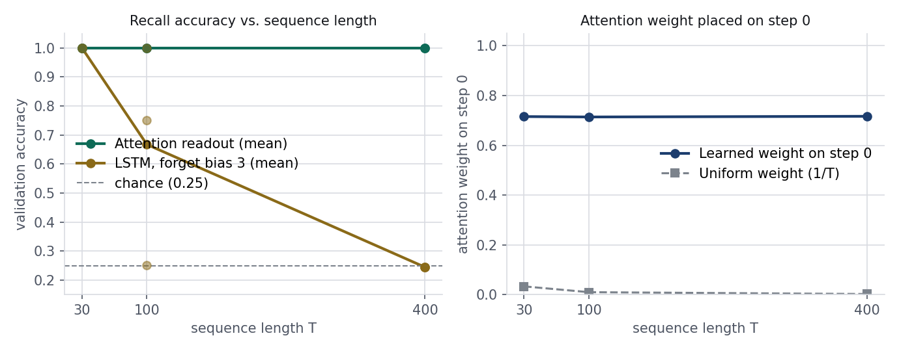

# Attention Against Recurrence

Attention built from scratch, then tested against recurrence, positions
and normalization on small tasks with known answers.

## Setup

```bash
python -m venv .venv
source .venv/bin/activate # Windows: .venv\Scripts\activate
pip install -r requirements.txt
```

## Run

```bash
python attention.py      # 1: my attention, checks against PyTorch
python recall.py         #2: attention readout against LSTM
python positions.py      #3: none, learned, sinusoidal
python depth_cost.py #4: 12-block stacks and timing
```

## Prediction (written before running the mixed-length training)

Before running the mixed-length experiment where training sequences are drawn at random from lengths 8, 16, and 24 instead of always using length 16, I predicted how learned and sinusoidal positional encodings would behave when tested at length 32. For the learned positional encoding, I expected accuracy at length 32 to improve slightly over fixed-length-16 training (because positions 16 to 23 are now trained instead of only 0 to 15), but still fall well short of solving length 32 because rows 24 to 31 in the lookup table are never seen during training and remain random initial noise. For the sinusoidal positional encoding, I expected accuracy at length 32 to improve much more strongly under mixed-length training. Because the sinusoidal formula is smooth and defined at every position without needing per row training and any fixed offset is a linear rotation of an earlier position seeing varied lengths (8, 16, and 24) during training should help the model learn a general relative-order rule rather than overfitting to a single fixed length of 16.

## Results

**1 — Verification and parameter counts:**
Implemented `scaled_dot_product_attention(q, k, v, mask=None)` and `MultiHeadAttention(d_model, n_heads)` from scratch using only tensor operations and `nn.Linear`. Inside the attention function, query-key dot products are divided by the square root of the key dimension (`sqrt(d_k)`), boolean masks are applied before the softmax by filling blocked positions with `-inf`, and the softmax is taken over the keys axis (`dim=-1`). Code assertions verify on every call that each row of weights sums to 1.0 and that all masked-out positions get a weight of exact 0.0. When compared against PyTorch's `F.scaled_dot_product_attention`, our function matched on random inputs both without a mask (`T_q=5, T_k=7`, maximum difference `2.38e-07`) and with a causal mask (`T=5`, maximum difference `2.38e-07`). After copying the stacked query, key, value, and output projection weights from `nn.MultiheadAttention` into our `MultiHeadAttention` module at `d_model=32` and `4` heads, our module matched PyTorch's output on unmasked self-attention (`T=6`, max diff `1.19e-07`), causal self-attention (`T=6`, max diff `1.19e-07`), and masked cross-attention with a context of a different length (`T_q=6, T_k=9`, max diff `1.19e-07`). Checking the parameter count at `d_model=32` gave 4,224 parameters for 1 head, 4,224 parameters for 2 heads, 4,224 parameters for 4 heads, and 4,224 parameters for 8 heads. The parameter count never changes because splitting into multiple heads is simply a reshape of the same four `32 x 32` linear projection layers (`w_q, w_k, w_v, w_o`) into `n_heads` smaller slices of width `32 // n_heads`, which adds no extra weights. Finally, applying a random pick to shuffle the input sequence along the time axis shuffled the output tensor in the exact same way (`mha(x[:, perm]) == mha(x)[:, perm]`, max diff `1.19e-07`), proving that attention by itself has no sense of token order.

**P2 — Delayed recall (Attention readout vs. LSTM, chance is 0.25):**
In the delayed-recall task, step 0 holds a one-hot class label (4 classes, so random guessing is 0.25) and every later step is pure noise. At sequence length `T = 30`, the attention readout achieved validation accuracies of `1.000`, `1.000`, and `1.000` across seeds 0, 1, and 2 (mean `1.000`), while placing attention weights of `0.7301`, `0.7424`, and `0.6742` on step 0 (mean `0.7155`, compared to a uniform weight of `1/30 = 0.0333`). At `T = 30`, the LSTM with forget gate bias 3.0 also solved the task, reaching `1.000`, `1.000`, and `1.000` across seeds 0, 1, and 2 (mean `1.000`). At sequence length `T = 100`, the attention readout again reached `1.000`, `1.000`, and `1.000` on seeds 0, 1, and 2 (mean `1.000`), putting weights of `0.7382`, `0.7459`, and `0.6577` on step 0 (mean `0.7139`, compared to `1/100 = 0.0100` uniform). In contrast, the LSTM began to break down at `T = 100`, scoring `0.252` (chance) on seed 0, `0.750` on seed 1, and `1.000` on seed 2 (mean `0.667`). By sequence length `T = 400`, the attention readout still achieved `1.000`, `1.000`, and `1.000` on seeds 0, 1, and 2 (mean `1.000`) with step-0 attention weights of `0.7406`, `0.7465`, and `0.6629` (mean `0.7167`, compared to `1/400 = 0.0025` uniform), whereas the LSTM collapsed completely to chance on every seed at `0.245`, `0.244`, and `0.245` (mean `0.245`).



Distance matters to the LSTM because its classifier only reads the final hidden state (`out[:, -1]`), meaning the class label from step 0 must survive `T - 1` sequential recurrent updates through noise, and the training gradient must travel `T - 1` steps backward through time. Distance does not matter to the attention readout because there is no recurrence: a single learned query looks at every step in one direct hop, recognizes the label features in step 0's key, and puts over 71% of its weight on step 0 whether the sequence is 30, 100, or 400 steps long. However, this experiment does not show that no LSTM could ever learn 100 or 400 steps if given more than 600 updates or different hyperparameter tuning and it does not show that attention "remembers" step 0, instead of carrying information forward in a state, attention simply looks back at the stored input sequence whenever needed.

**Positional encodings on the order task (chance is 0.50):**
In the order task, every sequence contains token 1 once and token 2 once among random filler tokens, and the model predicts whether 1 comes before 2 (chance accuracy is 0.50). When trained on fixed length 16 and tested at length 16 and length 32 across seeds 0, 1, and 2, the model with **no positions (`none`)** scored `0.552 / 0.503` on seed 0, `0.523 / 0.484` on seed 1, and `0.447 / 0.498` on seed 2 (mean `0.507` at length 16 and `0.495` at length 32), staying right at 0.50 chance because self-attention and mean pooling treat the sequence as an unordered bag of tokens. With **learned positions (`learned`)** trained at length 16, the model solved length 16 but fell short at length 32, scoring `1.000 / 0.633` on seed 0, `1.000 / 0.602` on seed 1, and `1.000 / 0.625` on seed 2 (mean `1.000` at length 16 and `0.620` at length 32). With **sinusoidal positions (`sinusoidal`)** trained at length 16, the model also solved length 16 and dropped at length 32, scoring `1.000 / 0.645` on seed 0, `1.000 / 0.662` on seed 1, and `1.000 / 0.743` on seed 2 (mean `1.000` at length 16 and `0.683` at length 32).

When switched to **mixed-length training (`mixed_lens = (8, 16, 24)`)** and tested at lengths 16, 32, and 48 across seeds 0, 1, and 2, the **learned position** model scored `0.987 / 0.711 / 0.545` on seed 0, `0.992 / 0.723 / 0.518` on seed 1, and `0.999 / 0.708 / 0.548` on seed 2 (mean `0.993` at length 16, `0.714` at length 32, and `0.537` at length 48). In contrast, the **sinusoidal position** model under mixed-length training scored `1.000 / 0.893 / 0.608` on seed 0, `1.000 / 0.901 / 0.594` on seed 1, and `1.000 / 0.933 / 0.758` on seed 2 (mean `1.000` at length 16, `0.909` at length 32, and `0.653` at length 48). These measurements agree closely with our prediction and explain the mechanism clearly: for learned positions, training up to length 24 updates rows 0 to 23 (which raises length-32 accuracy from `0.620` to `0.714` because three-quarters of the 32 positions are now trained), but rows 24 to 47 are still never trained and remain random noise, causing accuracy to collapse to `0.537` (near 0.50 chance) at length 48. For sinusoidal positions, mixed-length training prevented the weights from overfitting to length 16 and allowed the smooth trigonometric representation to extrapolate much better to length 32 (jumping from `0.683` to `0.909` mean accuracy), though pushing twice as far to length 48 still degraded accuracy to `0.653` because the model had never seen positions 24 to 47 during training and mean pooling averages 46 filler tokens alongside the 2 markers.

**12-block normalization and computational cost (`depth_cost.py`):**
To test how normalization layout affects deep stacks, we trained 12-block Transformers on the order task (length 16) for 400 updates at learning rate `3e-3` across seeds 0, 1, and 2 (chance is 0.50). In the **post-norm layout with no warmup (`norm="post", warmup=0`)**, where LayerNorm sits directly on the main residual path and rescales the signal after every block, the deep stack failed to train on all three seeds, scoring `0.552` on seed 0, `0.552` on seed 1, and `0.448` on seed 2 (mean `0.517`, stuck at chance). In the **post-norm layout with a 100-update warmup (`norm="post", warmup=100`)**, ramping the learning rate gently from 0 to `3e-3` over the first 100 steps stabilized early updates so all three seeds converged to `1.000`, `1.000`, and `1.000` (mean `1.000`). In the **pre-norm layout with no warmup (`norm="pre", warmup=0`)**, where LayerNorm is placed on the sublayer branch so the residual highway runs clean from input to output, all three seeds also converged to `1.000`, `1.000`, and `1.000` (mean `1.000`) without needing warmup.


Finally, I timed a forward plus backward pass (batch size 32, width 32, best of 3 repeats) for an LSTM layer and one multi-head attention layer across sequence lengths 100, 200, 400, and 800. At length `T = 100`, the LSTM took `6.46 ms` while attention took `4.13 ms` (with a `5.1 MB` score matrix across 4 heads). At `T = 200`, the LSTM took `14.22 ms` while attention took `10.07 ms` (`20.5 MB` score matrix). At `T = 400`, the LSTM took `27.12 ms` while attention took `31.49 ms` (`81.9 MB` score matrix), marking the crossover point where attention became slower than the LSTM. At `T = 800`, the LSTM took `52.67 ms` while attention jumped to `96.29 ms` (`327.7 MB` score matrix). Each doubling of sequence length roughly doubled the sequential LSTM time (`O(T)`), whereas attention started faster at short lengths due to parallel matrix multiplication but grew quadratically (`O(T^2)`) in time and memory as the `T x T` score matrix expanded.

## Conclusion

Attention removes the two main bottlenecks of recurrence: it computes all positions in parallel rather than waiting step-by-step, and it connects any two positions in a single hop so long distances no longer cause signals and gradients to vanish (solving 400 step recall at `1.000` accuracy where the open-gate LSTM fell to `0.245` chance). In addition, multi-head attention is a zero-parameter reshape (`4,224` parameters across 1, 2, 4, and 8 heads), and pre-norm residual connections allow 12-block stacks to train without the learning-rate warmup required by post-norm. In exchange, attention charges two clear costs: it is completely blind to sequence order unless positional encodings are added (`0.507` chance accuracy without positions), and its `T x T` pairwise score matrix causes time and memory to grow with the square of the sequence length (`96.29 ms` and `327.7 MB` at `T = 800`, compared to `52.67 ms` for the LSTM). Finally, our numbers stay strictly within the limits of our experiments: they come from two small synthetic tasks at width 32, a fixed budget of 400 to 800 updates, three random seeds per setting, and single-machine CPU timings, so they demonstrate the mechanisms of lookup, position, normalization, and `O(T^2)` scaling without claiming that no recurrent network could ever be tuned to learn longer horizons or that absolute sinusoidal positions extrapolate indefinitely (`0.653` at length 48).

## Known limitations

Even with mixed-length training on `(8, 16, 24)`, neither positional encoding generalized cleanly to length 48 (`0.537` for learned and `0.653` for sinusoidal), because learned tables have untrained rows beyond the maximum training length and absolute sinusoidal embeddings combined with global mean pooling still struggle on unseen positions and diluted filler tokens. With more time, we would implement relative or rotary positional encodings (RoPE) so attention scores depend directly on the distance between positions, and we would extend the timing benchmark to longer sequences and GPU kernels.