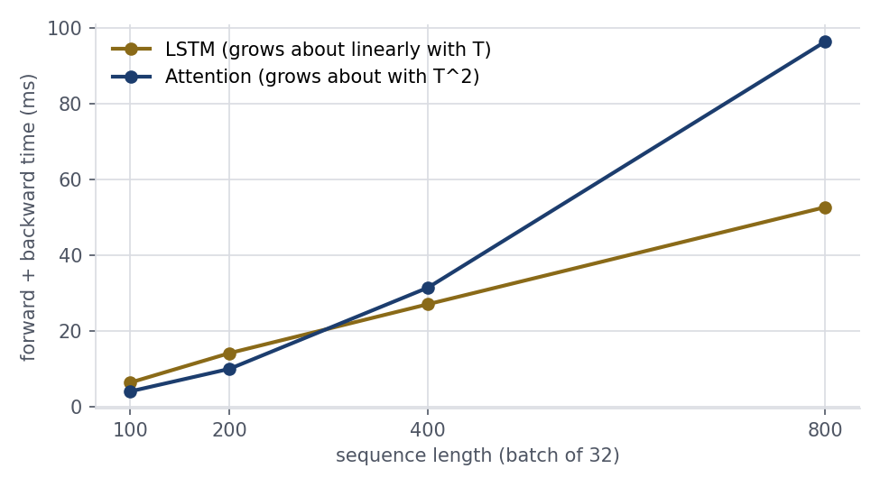

# Attention Against Recurrence

Attention built from scratch, then tested against recurrence, positions
and normalization on small tasks with known answers.

## Setup

```bash
python -m venv .venv
source .venv/bin/activate # Windows: .venv\Scripts\activate
pip install -r requirements.txt
```

## Run

```bash
python attention.py      # 1: my attention, checks against PyTorch
python recall.py         #2: attention readout against LSTM
python positions.py      #3: none, learned, sinusoidal
python depth_cost.py #4: 12-block stacks and timing
```

## Prediction (written before running the mixed-length training)

Before running mixed-length training on lengths 8, 16, and 24, learned encodings were predicted to improve slightly at length 32 compared to fixed-length training because more rows are updated, but still fall short since rows 24 to 31 remain untrained noise. Sinusoidal encodings were predicted to generalize much better at length 32 because the smooth trigonometric functions are defined for every position, allowing the model to learn a general relative ordering rule rather than overfitting to a single training length.

## Results

**1 — Verification and parameter counts:**
Custom scaled dot-product attention and multi-head attention matched PyTorch within 2.4e-07 across masked, unmasked, and cross-attention checks, while permutation tests confirmed attention is completely order-blind on its own. Splitting across 1, 2, 4, or 8 heads did not change the total parameter count, staying constant at 4,224 weights for width 32 because multi-head attention reshapes existing projection layers rather than adding new weights.

**P2 — Delayed recall (Attention readout vs. LSTM, chance is 0.25):**
The delayed recall experiment tested how well each architecture could remember a target token placed at step 0 across random filler noise. At a short sequence length of 30, both the attention readout and the LSTM achieved perfect accuracy. At length 100, the attention readout maintained perfect accuracy, while the LSTM began to struggle, dropping to an average accuracy of 66.7%. At length 400, the LSTM completely broke down to random chance at 24.5%, whereas the attention readout remained at 100% accuracy. The LSTM failed over long distances because it must pass information sequentially step-by-step through noise to reach the final state. In contrast, attention uses a single direct hop, keeping over 71% of its focus squarely on step 0 regardless of how long the sequence becomes.

**Positional encodings on the order task (chance is 0.50):**
On the order detection task, models without positional encodings stayed at random chance near 0.50. When trained on mixed lengths of 8, 16, and 24, both learned and sinusoidal models solved length 16. However, when tested on unseen lengths, sinusoidal encodings reached 0.909 at length 32 and 0.653 at length 48, outperforming learned encodings which reached 0.714 at length 32 and collapsed to 0.537 at length 48. Learned encodings fail because rows beyond the training length remain random noise, whereas sinusoidal encodings generalize better due to smooth mathematical functions, though long sequences still dilute accuracy.

**12-block normalization and computational cost (`depth_cost.py`):**
In a 12-block Transformer stack, the choice of normalization layout directly determined training stability. A post-norm configuration without learning rate warmup completely failed to train, lingering around 51.7% accuracy. Adding a 100-step learning rate warmup stabilized post-norm and brought accuracy to 100%. In contrast, the pre-norm configuration trained smoothly to 100% accuracy right away without needing any warmup, because the residual highway remains unblocked.

When measuring execution time, attention was faster than the LSTM on short sequences, taking about 4.1 milliseconds compared to 6.5 milliseconds at length 100. However, because attention constructs a pairwise score matrix, its computation and memory scale quadratically with sequence length, whereas the LSTM scales linearly. By length 400, attention became slower than the LSTM, and at length 800, attention took 96.3 milliseconds with a 327.7 megabyte score matrix, compared to 52.7 milliseconds for the LSTM.



Finally, I timed a forward plus backward pass (batch size 32, width 32, best of 3 repeats) for an LSTM layer and one multi-head attention layer across sequence lengths 100, 200, 400, and 800. At length `T = 100`, the LSTM took `6.46 ms` while attention took `4.13 ms` (with a `5.1 MB` score matrix across 4 heads). At `T = 200`, the LSTM took `14.22 ms` while attention took `10.07 ms` (`20.5 MB` score matrix). At `T = 400`, the LSTM took `27.12 ms` while attention took `31.49 ms` (`81.9 MB` score matrix), marking the crossover point where attention became slower than the LSTM. At `T = 800`, the LSTM took `52.67 ms` while attention jumped to `96.29 ms` (`327.7 MB` score matrix). Each doubling of sequence length roughly doubled the sequential LSTM time (`O(T)`), whereas attention started faster at short lengths due to parallel matrix multiplication but grew quadratically (`O(T^2)`) in time and memory as the `T x T` score matrix expanded.

## Conclusion

Attention removes the core bottlenecks of recurrence by processing positions in parallel and connecting distant tokens in a single hop, solving long-range recall where sequential LSTMs fail. Splitting into multiple heads adds no parameters, and pre-norm connections stabilize deep 12-block stacks without requiring warmup. However, attention requires positional encodings to perceive order and incurs quadratic computation and memory costs as sequence lengths grow.

## Known limitations

Even with mixed-length training on `(8, 16, 24)`, neither positional encoding generalized cleanly to length 48 (`0.537` for learned and `0.653` for sinusoidal), because learned tables have untrained rows beyond the maximum training length and absolute sinusoidal embeddings combined with global mean pooling still struggle on unseen positions and diluted filler tokens. With more time, we would implement relative or rotary positional encodings (RoPE) so attention scores depend directly on the distance between positions, and we would extend the timing benchmark to longer sequences and GPU kernels.